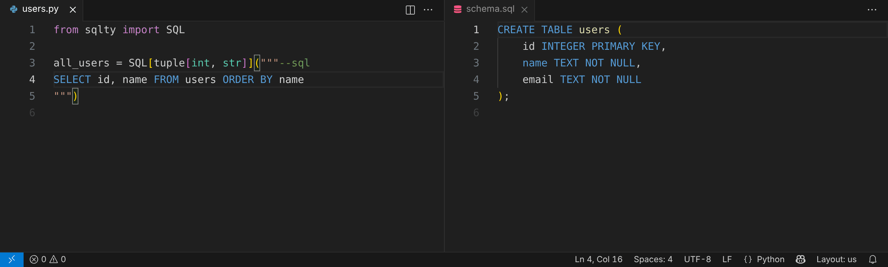

# sqlty for VS Code

Type-check the SQL in your Python code as you type: the diagnostics of `sqlty check`, each
on the span it is about, with a quick fix where `sqlty check --fix` has one, completion
of table and column names in the query strings it checks, and SQL highlighting in strings
marked `--sql`. The `.sql` files of named queries that the
[`queries`](https://sqlty.kuncar.dev/guide/sql-files/) key names get their diagnostics too.



The extension runs `sqlty server` from your project, so the editor and CI agree. Add sqlty
to the project's environment (`uv add --dev sqlty`); the extension bundles none.

On vscode.dev and github.dev, the extension highlights SQL only, since the browser runs no
`sqlty server`. The [documentation](https://sqlty.kuncar.dev/recipes/vscode/) covers the setup,
Restricted Mode, VS Code for the Web and other editors.

## Coming from another SQL highlighter

[python-string-sql](https://marketplace.visualstudio.com/items?itemName=ptweir.python-string-sql),
[Inline SQL](https://marketplace.visualstudio.com/items?itemName=qufiwefefwoyn.inline-sql-syntax),
[Python SQL](https://marketplace.visualstudio.com/items?itemName=AzharuddinSyed.python-sql) and
[SQL in Python Highlighter](https://marketplace.visualstudio.com/items?itemName=eluc1a.sql-in-python-highlighter)
mark SQL strings with the same `--sql` comment, so the strings you marked for them are already
highlighted and checked by sqlty against your schema. Keep one highlighter enabled, so one grammar
colors each string.

## Settings

| Setting | Default | Meaning |
|---------|---------|---------|
| `sqlty.path` | `[]` | `sqlty` executables to try first |
| `sqlty.interpreter` | `[]` | The interpreter whose `sqlty` runs; empty is the one selected in the Python extension |
| `sqlty.breaking.against` | empty | A baseline for `sqlty breaking`: a git revision, a `--save` snapshot or schema files |
| `sqlty.breaking.direction` | `both` | `both`, `forward` or `backward`, as `sqlty breaking --direction` |
| `sqlty.completion.enable` | `true` | Complete table and column names in query strings; needs sqlty 0.4.0 or newer |
| `sqlty.trace.server` | `off` | Log the protocol messages in the output channel |

`sqlty` is looked up in `sqlty.path`, then in the interpreter's environment, then on `PATH`.
The extension needs sqlty 0.3.0 or newer: an older `sqlty` is skipped, and when every one found
is older, an error names each with its version. The output channel logs the version that runs.

## Breaking changes

With `sqlty.breaking.against` set to `main`, each check also runs `sqlty breaking --against main`:

- Forward, with every check: your buffer's queries against the schema of `main`. Source:
  `sqlty breaking (forward)`.
- Backward, when the project loads and when a schema or a configuration file is saved: the
  queries of `main` against your schema, in every file. Source: `sqlty breaking (backward)`.
  A finding in a file you have changed since sits on its first line and names its line in
  `main`.

## Fix and format on save

`source.fixAll.sqlty` is `sqlty check --fix`; `source.format.sqlty` is `sqlty format`, which
lays out the query strings and leaves the rest to your Python formatter.

```json
{
  "[python]": {
    "editor.codeActionsOnSave": {
      "source.fixAll.sqlty": "explicit",
      "source.format.sqlty": "explicit"
    }
  }
}
```

## Development

```bash
npm ci
npm run check    # tsc, oxlint, oxfmt
npm test         # opens fixture/ in VS Code; needs a sqlty with `sqlty server` on PATH
```

`npm run demo` re-records `docs/assets/vscode-demo.gif` from `sqlty.vsix` in
[openvscode-server](https://github.com/gitpod-io/openvscode-server) at `$OPENVSCODE_SERVER`;
it needs `sqlty` on `PATH`, Playwright, ffmpeg and gifsicle.

`npm run package` writes `sqlty.vsix`. Each GitHub release publishes it under the
release's version, to the Visual Studio Marketplace and Open VSX, both by trusted publishing (no
token; the `vscode` environment); run the workflow by hand to publish the
version in `package.json` (`.github/workflows/vscode.yml`).
